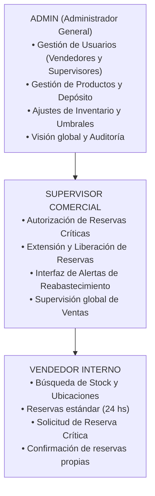
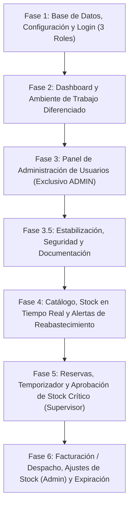

# Plan de Trabajo por Fases: Innovatrónica S.A. (Actualizado con Rol ADMIN)

Este plan incorpora la figura del **ADMIN (Administrador del Sistema / Dirección)** como máxima autoridad jerárquica por encima del **Supervisor Comercial** y del **Vendedor Interno**.

---

## 1. Jerarquía de Roles y Matriz de Permisos

### Matriz Comparativa de Capacidades:

| Módulo / Funcionalidad | VENDEDOR INTERNO | SUPERVISOR COMERCIAL | ADMIN GENERAL |
| :--- | :---: | :---: | :---: |
| **Búsqueda de stock y coordenadas de depósito** | ✅ | ✅ | ✅ |
| **Crear reservas normales (24 hs, sin stock crítico)** | ✅ | ✅ | ✅ |
| **Solicitar reserva en stock crítico ($S_D \le U_{\min}$)** | ✅ *(Pasa a Pendiente)* | ✅ *(Autoriza directo)* | ✅ *(Autoriza directo)* |
| **Aprobar / Rechazar reservas en stock crítico** | ❌ | ✅ | ✅ |
| **Extender / Liberar manualmente reservas activas** | ❌ | ✅ | ✅ |
| **Visualizar reservas** | Solo las propias | Todas las del equipo | Todas las del equipo |
| **Acceso a Interfaz de Alertas de Reabastecimiento** | Solo lectura | ✅ | ✅ |
| **Procesar Facturación / Despacho** (Descuento físico) | ❌ | ✅ | ✅ |
| **Registrar nuevos Vendedores y Supervisores** | ❌ | ❌ *(Bloqueado)* | ✅ **(Exclusivo Admin)** |
| **Editar usuarios y resetear contraseñas** | ❌ | ❌ | ✅ **(Exclusivo Admin)** |
| **Crear / Editar productos (SKU, nombre, ubicación)** | ❌ | ❌ | ✅ **(Exclusivo Admin)** |
| **Ajustar Stock Físico inicial y Umbrales Mínimos** | ❌ | ❌ | ✅ **(Exclusivo Admin)** |

---

## 2. Estructura de Fases de Trabajo

---

## 3. Detalle de Cada Fase

### Fase 1: Base de Datos, Configuración y Login (Soporte para 3 Roles)
> **Objetivo:** Asegurar la infraestructura de datos y autenticación con roles bien definidos y sin errores.

* **Base de Datos ([database.sql](file:///c:/wamp64/www/innovatronica/database.sql) & [config/db.php](file:///c:/wamp64/www/innovatronica/config/db.php)):**
  - Unificar nombre de base de datos a `innovatronica`.
  - Ampliar el `ENUM('VENDEDOR_INTERNO','SUPERVISOR_COMERCIAL','ADMIN')` en la tabla `usuarios`.
  - Crear cuentas iniciales de desarrollo con hashes de contraseña válidos (`$2y# Plan de Trabajo por Fases: Innovatrónica S.A. (Actualizado con Rol ADMIN)

Este plan incorpora la figura del **ADMIN (Administrador del Sistema / Dirección)** como máxima autoridad jerárquica por encima del **Supervisor Comercial** y del **Vendedor Interno**.

---

## 1. Jerarquía de Roles y Matriz de Permisos

### Matriz Comparativa de Capacidades:

| Módulo / Funcionalidad | VENDEDOR INTERNO | SUPERVISOR COMERCIAL | ADMIN GENERAL |
| :--- | :---: | :---: | :---: |
| **Búsqueda de stock y coordenadas de depósito** | ✅ | ✅ | ✅ |
| **Crear reservas normales (24 hs, sin stock crítico)** | ✅ | ✅ | ✅ |
| **Solicitar reserva en stock crítico ($S_D \le U_{\min}$)** | ✅ *(Pasa a Pendiente)* | ✅ *(Autoriza directo)* | ✅ *(Autoriza directo)* |
| **Aprobar / Rechazar reservas en stock crítico** | ❌ | ✅ | ✅ |
| **Extender / Liberar manualmente reservas activas** | ❌ | ✅ | ✅ |
| **Visualizar reservas** | Solo las propias | Todas las del equipo | Todas las del equipo |
| **Acceso a Interfaz de Alertas de Reabastecimiento** | Solo lectura | ✅ | ✅ |
| **Procesar Facturación / Despacho** (Descuento físico) | ❌ | ✅ | ✅ |
| **Registrar nuevos Vendedores y Supervisores** | ❌ | ❌ *(Bloqueado)* | ✅ **(Exclusivo Admin)** |
| **Editar usuarios y resetear contraseñas** | ❌ | ❌ | ✅ **(Exclusivo Admin)** |
| **Crear / Editar productos (SKU, nombre, ubicación)** | ❌ | ❌ | ✅ **(Exclusivo Admin)** |
| **Ajustar Stock Físico inicial y Umbrales Mínimos** | ❌ | ❌ | ✅ **(Exclusivo Admin)** |

---

## 2. Estructura de Fases de Trabajo

---

## 3. Detalle de Cada Fase

### Fase 1: Base de Datos, Configuración y Login (Soporte para 3 Roles)
> **Objetivo:** Asegurar la infraestructura de datos y autenticación con roles bien definidos y sin errores.

* **Base de Datos ([database.sql](file:///c:/wamp64/www/innovatronica/database.sql) & [config/db.php](file:///c:/wamp64/www/innovatronica/config/db.php)):**
  - Unificar nombre de base de datos a `innovatronica`.
  - Ampliar el `ENUM('VENDEDOR_INTERNO','SUPERVISOR_COMERCIAL','ADMIN')` en la tabla `usuarios`.
 de PHP), sin publicar contraseñas reales en la documentación. Las cuentas semilla deben exigir cambio de contraseña y no deben utilizarse en producción.
  - Incluir estados de reserva: `ACTIVA`, `PENDIENTE_AUTORIZACION`, `CONFIRMADA`, `FACTURADA`, `EXPIRADA`.
  - Configurar zona horaria estándar de Argentina (`America/Argentina/Buenos_Aires`).
* **Autenticación ([login.php](file:///c:/wamp64/www/innovatronica/login.php) & [includes/auth.php](file:///c:/wamp64/www/innovatronica/includes/auth.php)):**
  - Rediseño con interfaz corporativa limpia y profesional.
  - Funciones de verificación de sesión: `es_admin()`, `es_supervisor()`, `es_vendedor()`.

---

### Fase 2: Dashboard y Ambiente de Trabajo (Layout Dinámico por Rol)
> **Objetivo:** Diseñar la barra de navegación y las pantallas base adaptadas estrictamente a los privilegios de cada rol.

* **Navegación Dinámica ([includes/header.php](file:///c:/wamp64/www/innovatronica/includes/header.php)):**
  - **Vendedor:** Stock · Mis Reservas.
  - **Supervisor:** Stock · Todas las Reservas · Alertas de Reabastecimiento.
  - **Admin:** Stock · Todas las Reservas · Alertas de Reabastecimiento · **Gestión de Personal** · **Catálogo/Inventario**.
* **Dashboard Principal:**
  - Tarjetas con métricas ejecutivas:
    - Indicador de stock general.
    - Contador de alertas de reabastecimiento crítico.
    - Reservas activas y solicitudes pendientes de aprobación.
    - (Para Admin) Cantidad de empleados activos registrados.
* **Sistema de Diseño Visual ([assets/css/style.css](file:///c:/wamp64/www/innovatronica/assets/css/style.css)):**
  - Estética refinada, moderna y tecnológica (tonos ámbar/industrial, tipografía limpia, badges de rol diferenciados).

---

### Fase 3: Panel de Gestión de Usuarios y Permisos (Exclusivo ADMIN)
> **Objetivo:** Implementar el módulo donde únicamente el ADMIN puede registrar y administrar vendedores y supervisores.

* **Vista de Gestión de Personal (`usuarios.php`):**
  - Acceso restringido con redirección/error 403 para vendedores y supervisores.
  - Formulario de alta para nuevos empleados:
    - Nombre completo.
    - Nombre de usuario único.
    - Contraseña inicial encriptada con `password_hash`.
    - Selector de Rol: **VENDEDOR_INTERNO** o **SUPERVISOR_COMERCIAL**.
  - Tabla de usuarios con:
    - `id_empleado` único.
    - Nombre, usuario y badge de rol con colores distintivos.
    - Estado (activo/inactivo) y fecha de creación.
* **Seguridad en Backend ([api.php](file:///c:/wamp64/www/innovatronica/api.php)):**
  - Endpoints protegidos con verificación estricta `es_admin()`.

---

### Fase 3.5: Estabilización, Seguridad y Documentación
> **Objetivo:** cerrar hallazgos de seguridad y evitar regresiones antes de ampliar el sistema.

* Corregir la interpolación de datos de empleados en el modal de `usuarios.php`.
* Evitar que las respuestas de `api.php` expongan detalles internos de excepciones.
* Retirar credenciales de demostración de la interfaz de login y exigir cambio de contraseña a cuentas semilla con hashes conocidos.
* Hacer que `migracion_fase3_1_debe_cambiar_password.sql` tolere que la columna ya exista.
* Evitar que `database.sql` elimine tablas existentes; usarlo solo para instalación inicial.
* Alinear `docs/seguridad.md`, `docs/trazabilidad.md` y este plan con el estado real del código.
* Probar cada cambio en un entorno local/base descartable y registrar resultados. No declarar la fase cerrada sin pruebas ejecutadas.

---

### Fase 4: Catálogo, Stock en Tiempo Real e Interfaz de Alertas de Reabastecimiento
> **Objetivo:** Cumplir los requisitos de inventario, catálogo y la pantalla dedicada a reabastecimiento.

* **Buscador y Visualización de Stock ([index.php](file:///c:/wamp64/www/innovatronica/index.php)):**
  - Búsqueda reactiva por SKU, nombre, categoría y ubicación en depósito (`A1-01`, etc.).
  - Fórmulas en vivo: $S_F$, $S_C$, $S_D = S_F - S_C$.
* **Interfaz de Alertas de Reabastecimiento (`reabastecimiento.php`):**
  - Pestaña para Supervisores y Administrador.
  - Filtrado automático de componentes en peligro ($S_D \le U_{\min}$) con diferenciación entre crítico y quiebre total ($S_D = 0$).
  - Cálculo de cantidad sugerida a reponer: $(U_{\min} \times 2) - S_D$.
* **(Funcionalidad Admin) Gestión de Productos:**
  - El Admin podrá editar umbrales mínimos ($U_{\min}$) y ubicación en depósito.

---

### Fase 5: Reservas, Temporizador y Aprobación de Stock Crítico (Supervisor & Admin)
> **Objetivo:** Controlar el ciclo de reserva con temporizador en vivo y resolver el requerimiento de autorizaciones del supervisor.

* **Modales en Pantalla (Sin `prompt`/`confirm` nativos):**
  - Diálogos integrados en la UI para ingresar cantidad y vigencia (24 hs por defecto, configurable por Supervisor/Admin).
* **Temporizador Decreciente en Vivo:**
  - Countdown en formato `HH:MM:SS` que descuenta segundo a segundo.
* **Flujo de Autorización de Stock Crítico:**
  - Si un vendedor reserva y el stock resultante perfora el umbral ($S_D \le U_{\min}$), la reserva queda en estado `PENDIENTE_AUTORIZACION`.
  - El **Supervisor** (y el **Admin**) visualizan una notificación y botones directos para **Aprobar** o **Rechazar**.
  - Permiso extendido para **Extender** el tiempo de reserva o **Liberarla** manualmente.

---

### Fase 6: Facturación / Despacho, Ajuste de Inventario y Expiración Automática
> **Objetivo:** Cerrar el ciclo comercial completo e integrar mantenimiento de stock físico.

* **Acción Facturar / Despachar:**
  - Disponible para reservas `CONFIRMADA`.
  - Descuenta el stock físico real de la base de datos ($S_F = S_F - Cantidad$) y finaliza la reserva (`FACTURADA`).
* **(Funcionalidad Admin) Ajustes de Inventario:**
  - El Admin puede registrar ingresos de nuevo stock físico por compras a proveedores.
* **Automatización de Expiración:**
  - Rutina periódica en la base de datos que garantiza que las reservas vencidas pasen a `EXPIRADA` devolviendo el stock disponible.

---

## 4. Plan de Verificación y Testing

1. **Test de Autenticación y 3 Roles:**
   - Utilizar las credenciales configuradas en el entorno local (no guardar contraseñas en la documentación ni en el repositorio).
   - Verificar acceso de ADMIN a "Gestión de Personal".
   - Verificar que Supervisor y Vendedor no puedan crear usuarios ni acceder a endpoints administrativos.
   - Verificar que las cuentas semilla que conservan credenciales conocidas deban cambiar la contraseña antes de operar.
2. **Test de Alta de Usuarios (Admin):**
   - El admin crea un nuevo vendedor y un nuevo supervisor. Comprobar inicio de sesión con las nuevas cuentas.
3. **Test de Reserva con Stock Crítico:**
   - Vendedor intenta reservar producto con stock al límite -> Se crea en `PENDIENTE_AUTORIZACION`.
   - Supervisor ingresa a su panel y aprueba la solicitud -> Pasa a `ACTIVA` y comienza el temporizador decreciente.
4. **Test de Cierre del Circuito:**
   - Confirmar la reserva y luego marcarla como Facturada -> Comprobar que el `stock_fisico` disminuyó en la tabla de inventario.
